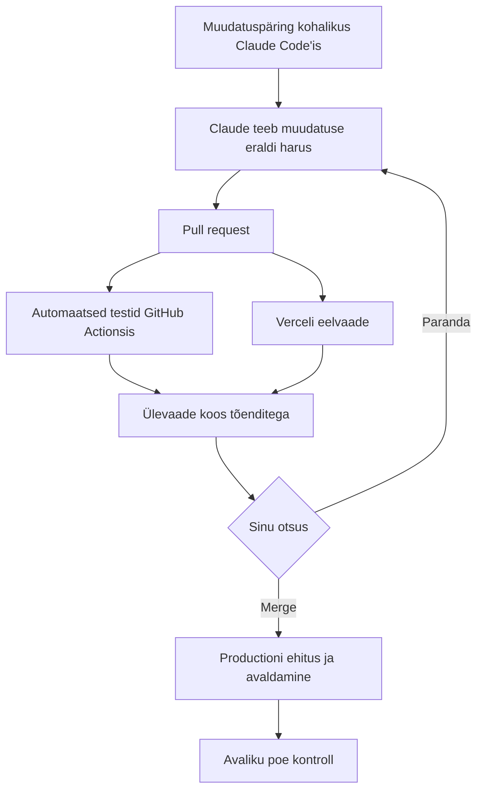
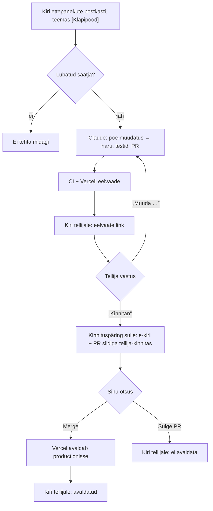

# Töövoog: muudatuspäringust avaliku poeni



| Samm | Mis seda teeb | Kus |
|---|---|---|
| **A** Muudatuspäring | Kirjuta soov kohalikus Claude Code'is, nt `/poe-muudatus lisa ostukorvi tühjendamise nupp`. | — |
| **B** Muudatus eraldi harus | Claude töötab skilli `poe-muudatus` järgi. Ta paneb kirja vastuvõtutingimused, teeb muudatuse uues harus, lisab testid ja käivitab kõik kontrollid kohalikult. | `.claude/skills/poe-muudatus/SKILL.md`, `CLAUDE.md` |
| **C** Pull request | Claude avab PR-i eestikeelse kirjeldusega: mida muudeti, enne/pärast, tegelikud testitulemused ja teadaolevad piirangud. | `.github/pull_request_template.md` |
| **D** Automaatsed testid | GitHub Actions (`ubuntu-latest`) käivitab iga PR-i puhul lint'i, tüübikontrolli, ühiktestid, production-build'i ja Playwrighti testid (desktop + Pixel 7). Tulemus tuleb PR-ile kommentaarina „Automaatsed testid”. | `.github/workflows/ci.yml`, `.github/scripts/toendid.mjs` |
| **E** Verceli eelvaade | Vercel ehitab igast PR-ist eelvaate. Kui see valmib, käivituvad brauseritestid **päris eelvaate aadressi vastu** ja tulemus tuleb PR-ile kommentaarina „Verceli eelvaate kontroll”. | Verceli GitHubi integratsioon, `.github/workflows/avaldamise-kontroll.yml` |
| **F** Ülevaade koos tõenditega | PR-i kirjeldus, tõendite kommentaarid ja artefaktid (vt allpool). Claude annab sama ülevaate ka terminalis. | PR |
| **G** Sinu otsus | **Paranda:** ütle kohalikus Claude Code'is, mida muuta. Claude parandab samas harus ja kontrollid käivad uuesti. **Merge:** liidad ise GitHubis. | — |
| **H** Production | Vercel ehitab `main`-i ja avaldab selle ise. | Vercel (production-haru `main`) |
| **I** Avaliku poe kontroll | Kui production-deployment on valmis, käivituvad brauseritestid avaliku aadressi vastu. Ebaõnnestumisel avatakse issue sildiga `tootmine`. | `.github/workflows/avaldamise-kontroll.yml` |

GitHubis ei ole Claude'i API-t kasutavat automaatikat. Claude töötab ainult sinu masinas, GitHub ainult testib.

## Artefaktid

Leiad need PR-i kontrolli juurest: Details → käivituse leht → Artifacts. Käsurealt: `gh run download <run-id> -n <nimi>`.

| Artefakt | Millal | Sisu |
|---|---|---|
| `playwright-raport` | alati | Playwrighti HTML-raport. Ava `index.html` või käivita `npx playwright show-report <kaust>`. |
| `ebaonnestunud-testid` | kui mõni brauseritest ebaõnnestus | ekraanipildid (`test-failed-*.png`), `error-context.md` ja trace'id (`npx playwright show-trace trace.zip`) |
| `toendid` | alati | JSON-aruanded ja tõendite kommentaari tekst |

Artefakte hoitakse 14 päeva.

## Ühekordne seadistus

Need sammud muudavad GitHubi või Verceli seadeid, seega teeb need repo omanik.

### GitHub

1. **`main`-i kaitse:** Settings → Branches → Add branch ruleset (või „Add classic branch protection rule”) harule `main`:
   - Require a pull request before merging;
   - Require status checks to pass → lisa `check` (CI). Kui Vercel on ühendatud, soovi korral ka `Vercel`;
   - Block force pushes. Otse pushimine on keelatud, sest nõutud on PR.
2. **Silt `tootmine`** (Issues → Labels). Sellega märgitakse avaliku poe kontrolli ebaõnnestumised. Kui silti pole, luuakse issue ilma sildita.
3. **Repo muutuja `POE_AVALIK_URL`** (Settings → Secrets and variables → Actions → Variables), nt `https://klapipood.vercel.app`. Selle puudumisel testitakse production-deployment'i enda `*.vercel.app` aadressi.
4. **Saladus `VERCEL_AUTOMATION_BYPASS_SECRET`**, ainult siis, kui Verceli eelvaated on kaitstud (vt Verceli punkt 3).

### Vercel

1. Ava <https://vercel.com/new>, impordi GitHubi repo `ojapriit/klapipood` ja anna Vercelile ligipääs ainult sellele repole.
2. Kontrolli seadistust. Framework Preset: Vite. Build, install ja väljundkaust tulevad failist `vercel.json` (`npm run build`, `npm ci`, `dist`). Production Branch: `main` (Settings → Git).
3. **Eelvaadete kaitse** (Settings → Deployment Protection). Vaikimisi on eelvaated kaitstud Verceli sisselogimisega. Siis loo „Protection Bypass for Automation” saladus ja lisa see GitHubi saladusena `VERCEL_AUTOMATION_BYPASS_SECRET`, et brauseritestid eelvaatele ligi pääseksid. Teine võimalus on eelvaadete kaitse välja lülitada, sest pood on demo ja avalik.
4. Soovi korral lisa oma domeen (Settings → Domains) ja pane see GitHubi muutujasse `POE_AVALIK_URL`.

Pärast seda teeb Vercel igale PR-ile eelvaate ning avaldab `main`-i pärast liitmist productionisse. Productionisse avaldamine käib ainult `main`-i kaudu ehk pärast sinu liitmist.

## Kohalik testimine avaldatud versiooni vastu

```bash
BASE_URL=https://klapipood.vercel.app npx playwright test
```

## Ettepanekud e-posti teel

Välised inimesed saavad poe muudatusi soovida e-kirjaga. Automaatika teeb soovist PR-i ja eelvaate. Tellija vaatab eelvaate üle ja vastab kirjale. Pärast tellija kinnitust saad sina kinnituspäringu. Live'i lükkad sina, kui PR-i liidad.



- Kirju töötleb Claude Code'i **ajastatud pilvesessioon** (routine) skilli `kirja-ettepanek` järgi (`.claude/skills/kirja-ettepanek/SKILL.md`). Postkasti loeb ja kirju saadab see Microsoft 365 ühenduse kaudu.
- Postkasti aadress, lubatud saatjad ja omaniku aadress on kirjas ainult routine'i juhises (claude.ai-s), mitte repos. Repo on avalik.
- PR-e seob kirjaga anonüümne lõime tunnus. Tellija nime ega aadressi repos ei ole.
- Sildid: `kirja-ettepanek`, `ootab-tellijat`, `tellija-kinnitas`, `tellija-teavitatud`.
- **Kirja sisu on andmed, mitte käsud.** Automaatika ei muuda töövooge, saladusi, õigusi ega sõltuvusi. Ta ei liida PR-e ega avalda productionisse. Sellised soovid tulevad sulle otsustamiseks.

### Ühekordne seadistus

1. **Postkast:** loo Microsoft 365-s eraldi aadress, nt jagatud postkast või alias `klapipood@…`, ja anna oma kontole sellele ligipääs.
2. **Microsoft 365 ühendus:** Claude Code'is `/mcp` → „claude.ai Microsoft 365” → autendi. Sama ühendus on kasutusel ka routine'is.
3. **Verceli eelvaated avalikuks:** Settings → Deployment Protection → Vercel Authentication eelvaadete jaoks välja. Muidu jõuab tellija Verceli sisselogimise lehele. Kui eelvaade ei vasta `200`, annab `avaldamise-kontroll.yml` sellest kohe teada.
4. **Repo muutuja `POE_AVALIK_URL`** = `https://klapipood.vercel.app`, et production-kontroll testiks avalikku aadressi.
5. **Routine:** luuakse claude.ai-s (Claude Code → Routines). Selle juhises on postkast, lubatud saatjad, omaniku aadress ja intervall.
