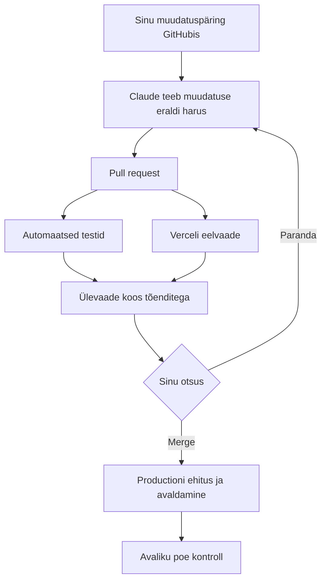

# Töövoog: muudatuspäringust avaliku poeni

| Samm | Mis seda teeb | Kus |
|---|---|---|
| **A** Muudatuspäring | Issue vormiga „Muudatuspäring”. Vorm lisab sildid `muudatus` ja `claude`. | `.github/ISSUE_TEMPLATE/muudatus.yml` |
| **B** Muudatus eraldi harus | Silt `claude` käivitab Claude'i, mis töötab harus `claude/…` skilli `poe-muudatus` järgi: vastuvõtutingimused, kood, testid ja kõik kontrollid. | `.github/workflows/claude.yml`, `.claude/skills/poe-muudatus/SKILL.md` |
| **C** Pull request | Claude avab PR-i viitega `Closes #<issue>`. | — |
| **D** Automaatsed testid | Lint, tüübikontroll, ühiktestid, build ja brauseritestid (desktop + Pixel 7). Tulemus tuleb PR-ile kommentaarina „Automaatsed testid”. | `.github/workflows/ci.yml`, `.github/scripts/toendid.mjs` |
| **E** Verceli eelvaade | Vercel ehitab igast PR-ist eelvaate. Kui see valmib, käivituvad brauseritestid **päris eelvaate aadressi vastu**. Tulemus tuleb PR-ile kommentaarina „Verceli eelvaate kontroll”. | Verceli GitHubi integratsioon, `.github/workflows/avaldamise-kontroll.yml` |
| **F** Ülevaade koos tõenditega | PR-i kirjelduses on Claude'i eestikeelne ülevaade (vastuvõtutingimused, enne/pärast, tulemused). Selle all on kaks automaatset tõendite kommentaari ja eelvaate link. | PR |
| **G** Sinu otsus | **Paranda:** kirjuta PR-ile kommentaar `@claude paranda: <mida>`. Claude parandab samas harus ja kõik kontrollid käivad uuesti. **Merge:** liidad ise. Claude ei liida kunagi. | GitHub |
| **H** Production | Vercel ehitab `main`-i ja avaldab selle ise. | Vercel (production-haru `main`) |
| **I** Avaliku poe kontroll | Kui production-deployment on valmis, käivituvad brauseritestid avaliku aadressi vastu. Ebaõnnestumisel avatakse issue sildiga `tootmine`. | `.github/workflows/avaldamise-kontroll.yml` |

## Ühekordne seadistus

Need sammud muudavad repo, Verceli või saladuste seadeid, seega teeb need repo omanik.

1. **Claude GitHubis:** käivita terminalis Claude Code'is `/install-github-app`. See paigaldab Claude'i GitHubi rakenduse ja lisab repole saladuse `CLAUDE_CODE_OAUTH_TOKEN`. Teine võimalus on API-võti: paigalda <https://github.com/apps/claude> ja lisa saladus `ANTHROPIC_API_KEY`.
   Rakendus on vajalik, sest Claude'i tehtud pushid peavad käivitama CI. Tavalise `GITHUB_TOKEN`-iga tehtud pushid seda ei tee.
2. **Vercel:** ava <https://vercel.com/new>, impordi repo `ojapriit/klapipood` (Framework: Vite) ja vali production-haruks `main`. Pärast seda teeb Vercel igale PR-ile eelvaate ja avaldab `main`-i productionisse.
3. **Eelvaadete kaitse:** kui Verceli eelvaated on kaitstud (Settings → Deployment Protection), loo samas „Protection Bypass for Automation” saladus. Lisa see GitHubi saladusena nimega `VERCEL_AUTOMATION_BYPASS_SECRET`.
4. **Avalik aadress:** lisa repo muutuja (Settings → Secrets and variables → Actions → Variables) `POE_AVALIK_URL`, nt `https://klapipood.vercel.app`. Selle puudumisel testitakse production-deployment'i enda aadressi.
5. **Sildid:** `claude`, `muudatus` ja `tootmine`.
6. **`main`-i kaitse** (Settings → Branches → Add rule `main`):
   - nõua pull requesti;
   - nõua staatuskontrolli `check` (CI) ja soovi korral ka Verceli kontrolli;
   - keela otse pushimine.

   See on oluline kaitse: Claude'i töövool on kirjutusõigus, nii et ainult tööriistade keeld ei ole piisav.

## Kasutamine

- **Uus muudatus:** Issues → New issue → „Muudatuspäring”.
- **Täpsustus või parandus:** kirjuta issue'sse või PR-i kommentaar `@claude …`.
- **Kohalik eelvaate või avaliku poe test:** `BASE_URL=https://… npx playwright test`.

Claude'i saab käivitada ainult kasutaja, kellel on repos kirjutusõigus. Repo on avalik, aga võõrad kasutajad Claude'i käivitada ei saa.
